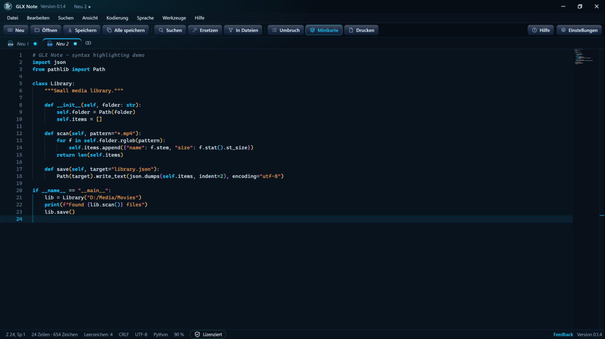

🌍 Sprachen: [🇺🇸 English](README.md) | [🇩🇪 Deutsch](README.de.md)

# 💠 GLX Note

### Der schnelle Texteditor im GLX-Design.

*Syntax-Farben, Reiter und Suchen und Ersetzen auch in ganzen Ordnern.* ⚡

   

---

## ⬇️ Download

👉 Neueste Version: [Releases](../../releases/latest)  
👉 Shop und Lizenzen: [glx-tools.de](https://glx-tools.de/product/glx-note/)

---

## 📸 Überblick & Screenshots

### 1️⃣ Syntax-Farben

### 2️⃣ Suchen und Ersetzen

### 3️⃣ Sprachauswahl

---

## ✨ Funktionen

- 🚀 **Syntax-Farben:** Farben für über 80 Sprachen.
- 🧩 **Reiter:** Viele Dateien nebeneinander offen.
- ⚙️ **Suchen und Ersetzen:** Auch in ganzen Ordnern.
- 🔒 **Kodierungen:** Alle gängigen Textkodierungen.
- 📂 **Sitzung:** Öffnet nach dem Neustart deine Dateien und Position wieder.
- ⚡ **Zwei Sprachen:** Deutsch und Englisch.

---

## 🧩 Systemanforderungen

- Windows 10 oder 11 (64 Bit)

---

## 🧪 Testzeitraum & Lizenz

14 Tage kostenlos mit allen Funktionen, danach eine Lizenz über [glx-tools.de](https://glx-tools.de).

---

## 🔗 Mehr zu diesem Produkt

👉 [glx-tools.de](https://glx-tools.de/product/glx-note/)  
Support: **info@glx-tools.de**

---

## 📄 Lizenz

Copyright © 2026 GLX Tools – Gordon Lehmann. Alle Rechte vorbehalten.  
Dies ist proprietäre kommerzielle Software. Es wird keine Open-Source-Lizenz gewährt. Dieses Repository enthält nur Release-Downloads und Dokumentation; der Quelltext wird nicht veröffentlicht.

---

Mit ❤️ gemacht von **Dreamdancer100**

