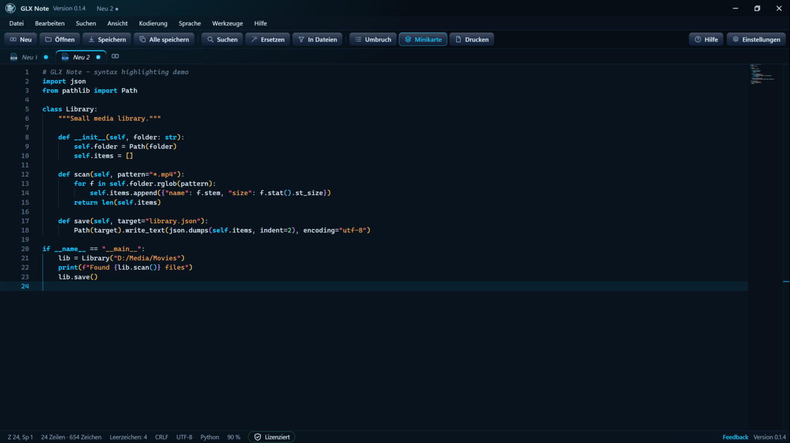
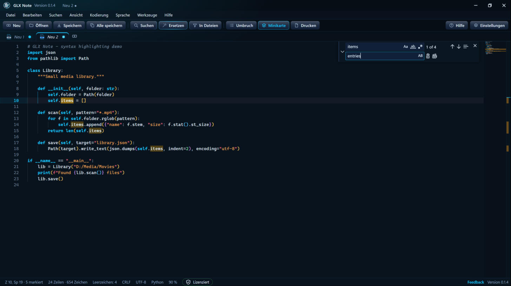
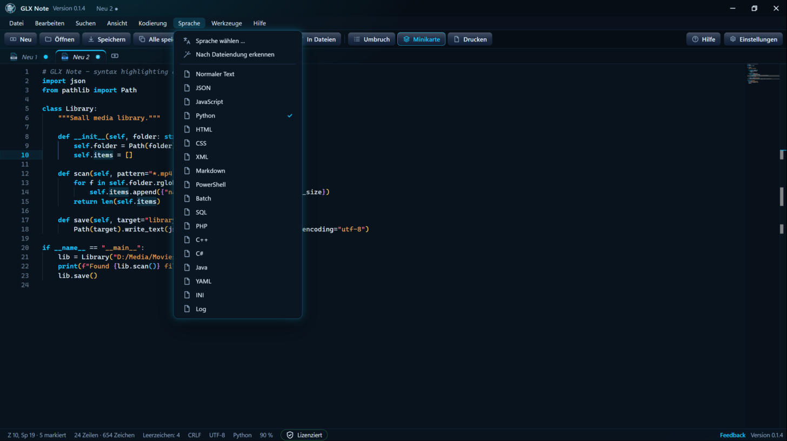

🌍 Languages: [🇺🇸 English](README.md) | [🇩🇪 Deutsch](README.de.md)

# 💠 GLX Note

### The fast text editor in the GLX look.

*Syntax highlighting, tabs and folder-wide search and replace.* ⚡

   

---

## ⬇️ Download

👉 Latest version: [Releases](../../releases/latest)  
👉 Shop and licences: [glx-tools.de](https://glx-tools.de/product/glx-note/)

---

## 📸 Overview & Screenshots

### 1️⃣ Syntax highlighting

### 2️⃣ Search and replace

### 3️⃣ Language selection

---

## ✨ Features

- 🚀 **Syntax highlighting:** Colors for more than 80 languages.
- 🧩 **Tabs:** Many files open side by side.
- ⚙️ **Search and replace:** Also across whole folders.
- 🔒 **Encodings:** All common text encodings.
- 📂 **Session:** Reopens your files and position after restart.
- ⚡ **Two languages:** German and English.

---

## 🧩 Requirements

- Windows 10 or 11 (64-bit)

---

## 🧪 Trial & License

14 days free with all features, then a licence from [glx-tools.de](https://glx-tools.de).

---

## 🔗 More about this product

👉 [glx-tools.de](https://glx-tools.de/product/glx-note/)  
For support: **info@glx-tools.de**

---

## 📄 License

Copyright © 2026 GLX Tools – Gordon Lehmann. All rights reserved.  
This is proprietary commercial software. No open-source license is granted. This repository contains release downloads and documentation only; the source code is not published.

---

Made with ❤️ by **Dreamdancer100**

